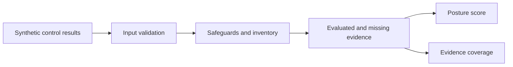

# ORBELION Cibersecurity

Engineering portfolio exploring evidence-based security assessment.

An independent case study with conceptual architecture and an original, runnable synthetic example. Public material is deliberately limited to general engineering principles; production code, configuration and operational evidence remain private.

## Conceptual architecture



This diagram describes the public example. Broader design topics are discussed as principles, not as delivered integrations.

## Engineering principles

- Inventory alone does not prove that a safeguard is effective.
- Posture and coverage answer different questions and must be shown together.
- Missing or incomplete evidence must remain visible.
- Duplicate control IDs must be rejected to avoid distorted results.
- External collection needs explicit authorization and bounded execution.
- Uncertain external actions require reconciliation before retrying.
- Production tenant isolation requires enforced identity and storage boundaries.

See [public example capabilities](docs/VERIFIED_CAPABILITIES.md) and [failure considerations](docs/FAILURE_MODEL.md).

## Run the example

Python 3.12 or newer; standard library only:

```sh
python examples/synthetic_posture.py
python -m unittest discover -s tests -v
python scripts/validate_publication.py
```

The invented input produces **50% posture** and **66.67% coverage**: one passing and one failing safeguard, one unavailable safeguard, and one inventory result excluded from scoring.

Posture = passing / evaluated safeguards. Coverage = evaluated / requested safeguards. Without evaluated safeguards, posture is null.

## Scope and limits

The example demonstrates validation and scoring only. It does not connect to providers, authenticate, collect evidence, persist reports, remediate or send notifications. Synthetic results are not an audit, compliance certification or proof of production readiness.

## Portfolio maintenance

Maintained as an independent public companion within [Orbelion-Platform](https://github.com/Orbelion-Platform), using manually curated documentation and synthetic examples.

See [publication scope](PUBLICATION_SCOPE.md), [maintenance](docs/MAINTENANCE.md) and [security](SECURITY.md).
